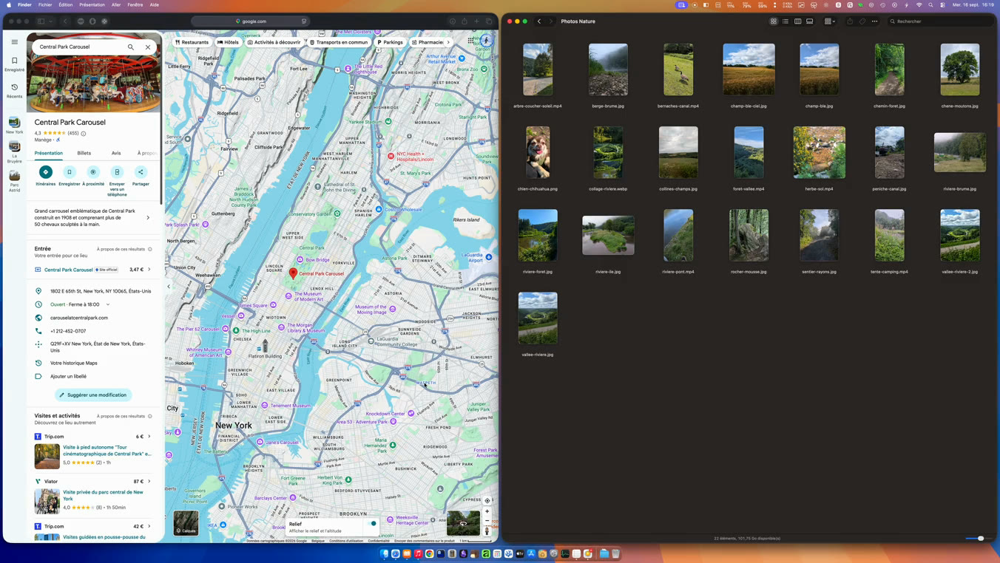
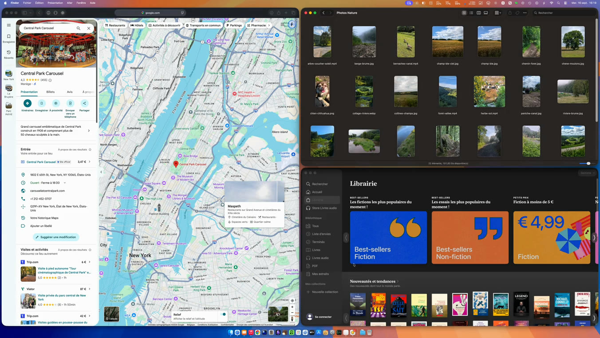

# Gridelio

**A macOS window manager that keeps your windows in order.**

Gridelio arranges your windows on a grid, splits or swaps them as you drag, and keeps a separate layout for each macOS desktop. The window you open lands where it belongs — you stop dragging rectangles around all day.

[Download for macOS](https://gridelio.com/downloads/Gridelio.dmg) · [Website](https://gridelio.com) · [Install guide](https://gridelio.com/install) · [Changelog](CHANGELOG.md)


---

## What it is

Gridelio is a native, menu-bar app for macOS. It has two ways of working:

- **Auto Layout** — when you open or close a window, the others rearrange themselves around it. Opening an app splits the cell of the active window in half; closing one hands its space to a neighbour. Every placement is verified before it is applied, and a failed placement is rolled back rather than left half-done.
- **Manual grids** — you drag a window, the grid appears, and you drop it where you want: on the centre of another window to swap, on an edge to split the cell, on the gap between two windows to resize both.

Each desktop (Space) keeps its own layout. Switch desktops and the arrangement comes back.

**Who it is for:** people who work with many windows at once and want them tidy without thinking about it — developers, designers, anyone who lives in a dozen apps on a 27-inch screen.

## Features

| | |
|---|---|
| **Auto Layout** | Windows arrange themselves when one opens or closes. Weighted columns and rows, adjustable by dragging the dividers. |
| **Visual grid while dragging** | The target zones appear under the window, with a preview of what will happen ("Swap", "Split 1180 × 720"). |
| **Split, swap, cut, merge** | Drop on an edge to split a cell, on a centre to swap two windows, on a divider to resize both sides. |
| **One layout per desktop** | Every Space remembers its own grid, restored on return and after a relaunch. |
| **Eight standard layouts** | Columns, main + stack, thirds, halves, focus layouts, and more. |
| **Custom layouts** | Build your own grids, save them, and copy them to another desktop. |
| **Per-app rules** | Keep a given app on a given cell, or out of the grid entirely. |
| **Menu bar extras** | A desktop bar with switchable styles, colour palettes, and a disks widget. |
| **Keyboard shortcuts** | Snap, focus, switch desktops, and apply layouts — all remappable in Settings. |
| **Automation** | A local command-line interface (`gridelio`) for scripting layouts. Off by default on new installs; enable it in Settings › Automation. |
| **Local and private** | No account, no cloud, no telemetry. Layouts, shortcuts and settings stay on your Mac; only your licence key is checked, with Gumroad. |

See it in action: [gridelio.com](https://gridelio.com) (interactive demo) · [demo video](https://gridelio.com/assets/videos/2.mp4)

## Screenshots



*Safari and Photos tiled side by side — each window takes the half it was given.*



*A three-window layout: Safari on the left, Photos and Books stacked on the right.*

Both images are frames from the official Gridelio demo video; nothing is staged beyond that recording.

## Download and install

### Option 1 — DMG

1. Download **[Gridelio.dmg](https://gridelio.com/downloads/Gridelio.dmg)**.
2. Open the disk image and drag **Gridelio** into *Applications*.
3. **First launch** — macOS warns you that the app comes from an unidentified developer (see [Code signing](#code-signing)). Allow it once:
   - **macOS 15 Sequoia and later:** double-click Gridelio, dismiss the warning, then open **System Settings › Privacy & Security**, scroll down to **Security**, click **Open Anyway**, and authenticate. Since macOS 15, right-clicking the app no longer bypasses this warning.
   - **macOS 14 Sonoma:** right-click (or Control-click) Gridelio › **Open** › **Open**.
   - Installed with Homebrew? The warning usually does not appear.
4. Grant the **Accessibility** permission when asked — it is what lets Gridelio read and move windows.

Step-by-step guide: **[gridelio.com/install](https://gridelio.com/install)**.

### Option 2 — Homebrew

```bash
brew install --cask gaorfg-bit/gridelio/gridelio
```

That one command installs the cask straight from the tap. If Homebrew refuses to load a third-party tap, trust it once and retry:

```bash
brew trust gaorfg-bit/gridelio
```

Cask source: [gaorfg-bit/homebrew-gridelio](https://github.com/gaorfg-bit/homebrew-gridelio)

## Requirements

- **Apple Silicon Mac** (M1 or later). Intel Macs are not supported — support was dropped in version 1.1.1 to keep the app small.
- **macOS 14 Sonoma** or later.
- **Accessibility permission** (required by macOS to move and resize windows). Nothing else is accessed.

## Pricing and licence

- **15-day free trial**, full features, no credit card.
- **€4.99, one time.** No subscription.
- One licence per Mac; 1.x updates are included.
- Purchase is handled by Gumroad. After the trial, the app asks for a licence key and your settings stay intact.

## Updates

Gridelio checks [`gridelio.com/updates.json`](https://gridelio.com/updates.json) for a newer build and can install it from the app. Updates never require reinstalling from the website.

Current public release:

| Version | Build | Date | SHA-256 of the DMG |
|---|---|---|---|
| 1.2.1 | 127 | 2026-11-11 | `34038e837a28be8b1265afa103fd5c2ce7a6b371a6479a98fe3581dae30bc179` |

All releases are listed in [CHANGELOG.md](CHANGELOG.md).

## Code signing

Gridelio is signed **ad hoc** and is **not notarized by Apple** — that is why macOS shows a warning on first launch. Notarization requires a paid Apple Developer account; it is not in place yet. The app is distributed directly from gridelio.com, outside the App Store.

Verify what you downloaded:

```bash
shasum -a 256 ~/Downloads/Gridelio.dmg
# must match the table above
```

## Support and bug reports

- **Email:** [grideliosupport@gmail.com](mailto:grideliosupport@gmail.com) — questions, licence issues, anything.
- **Bugs and feature requests:** [open an issue](../../issues). Please include your macOS version, your Gridelio version (menu bar › Gridelio › About Gridelio), and what you did just before the problem.
- **Installation problems:** [gridelio.com/install](https://gridelio.com/install).

## Source code and licence

Gridelio is **proprietary, commercial software**. It is **not** open source and no source licence is granted.

- The source code is not published, and this repository contains no source code.
- All rights reserved. You may not copy, modify, redistribute, resell or repackage the application or its disk image.
- The disk image is free to download and evaluate for the 15-day trial.
- This repository exists to document releases, provide the checksums, and collect bug reports. It carries no licence of its own beyond the copyright notice below.

© 2026 Gridelio. All rights reserved.

macOS and Apple Silicon are trademarks of Apple Inc. Gridelio is not affiliated with, endorsed by, or sponsored by Apple.
